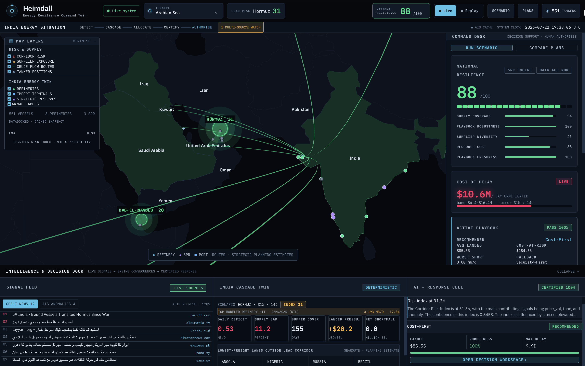
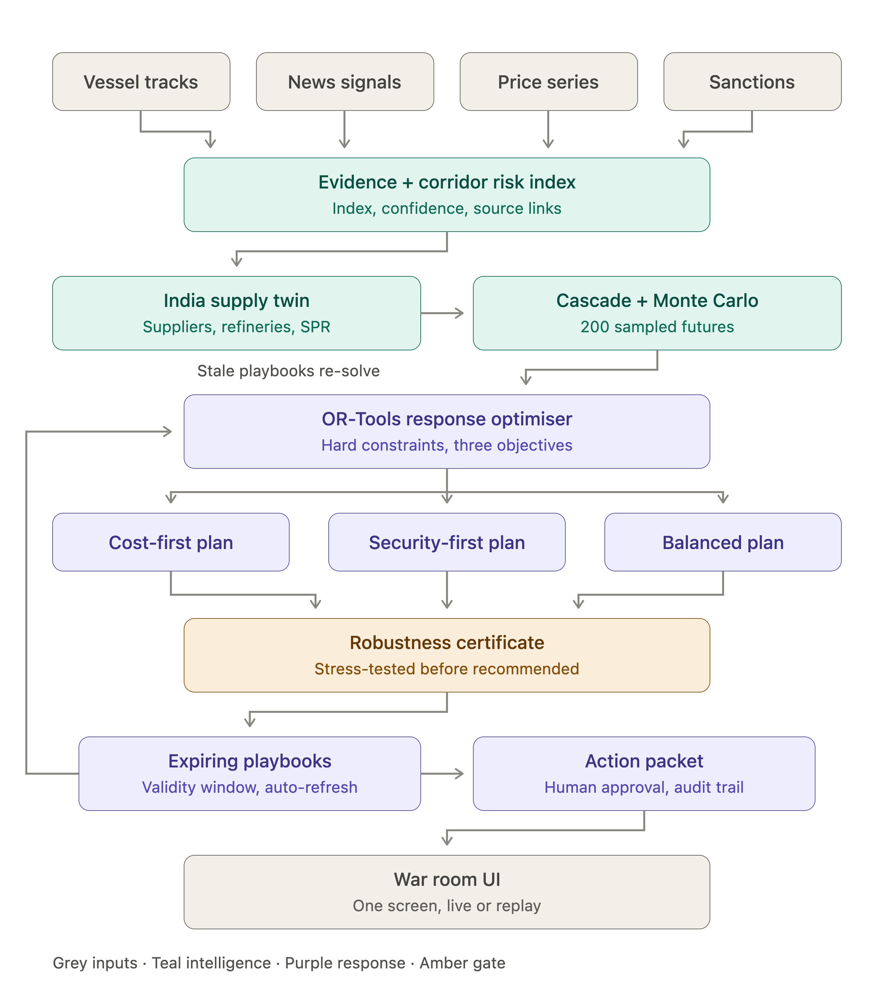

<h1 align="center">HEIMDALL</h1>

<p align="center">
  <strong>AI Energy Resilience Command Twin for India</strong><br />
  Detect disruption early. Model the cascade. Pre-compute a feasible response. Keep humans in command.
</p>

<p align="center">
  ET AI Hackathon 2026 · AI-Driven Energy Supply Chain Resilience for Import-Dependent Economies
</p>

<p align="center">
  
  
  
  
  
  
</p>



> **The response exists before the crisis does.**

HEIMDALL is a live, cache-backed and replay-capable decision platform for energy-crisis
procurement teams. It connects geopolitical evidence, tanker activity, sanctions and commodity
prices to India's suppliers, routes, refineries, commercial inventory and strategic reserves—then
generates response plans that are feasible, stress-tested and ready for human approval.

## Why HEIMDALL

Most monitoring products stop at *what happened*. HEIMDALL is built around the next three
questions: *What does it do to India's energy system? What should we do now? Can we defend that
decision?*

| Detect | Model | Allocate | Defend |
|---|---|---|---|
| Fuse news, AIS, prices and sanctions into an explainable **Corridor Risk Index** | Propagate disruption through suppliers, refineries, inventory, SPR and price pressure | Generate Cost-First, Security-First and Balanced plans with **OR-Tools** | Stress-test every plan, retain provenance and require human approval |

The governing doctrine is simple:

> **LLMs interpret evidence. Simulators calculate consequences. Optimisers make quantities feasible. Humans approve decisions.**

## What judges should notice

- **Pre-computed, expiring playbooks:** a viable response can exist before an alert fires. Every
  playbook carries its input snapshot, validity window, expiry reason and regeneration triggers.
- **A certificate before a recommendation:** no plan earns the recommended badge until it survives
  seeded future scenarios and reports its worst shortfall, cost-at-risk, delay and failure modes.
- **A real optimisation model:** supplier, grade, volume, refinery, route, arrival window,
  commercial inventory and SPR actions are decision variables—not generated prose.
- **Evidence that can be cross-examined:** every number traces to an engine output or sourced
  configuration; confidence, source links, contradictory evidence and data age remain visible.
- **Replay as proof, not decoration:** historical events are processed chronologically with a
  future-data leakage guard and compared against a reactive baseline.
- **Graceful degradation:** source failure falls back to visibly aged cache. The rehearsed demo
  remains fully usable without venue Wi-Fi.

## System architecture



### Decision loop

1. **Signal harvesters** ingest AIS vessel positions, geopolitical news, Brent prices and OFAC
   sanctions data.
2. **Evidence and risk intelligence** produce a 0–100 Corridor Risk Index plus a separate
   confidence score and provenance ledger.
3. **India Supply Twin** maps corridor exposure into supplier, refinery, inventory and SPR effects.
4. **Cascade and Monte Carlo engines** calculate deterministic impact and evaluate 200 seeded
   uncertain futures.
5. **OR-Tools optimiser** solves three objective presets under hard operational constraints.
6. **Robustness Certificate** accepts or rejects plans and recommends a fallback.
7. **Expiring playbooks** refresh when prices, risk, sanctions, vessel availability or corridor
   state move beyond configured thresholds.
8. **Action Packet** packages the recommendation, audit trail, assumptions, risks and required
   approvals. HEIMDALL recommends; a human authorises.

## Six protected capabilities

### 1. Evidence-backed Corridor Risk Index

An explainable 0–100 index with a separate confidence score, component contributions, evidence
links, affected assets and freshness. It is explicitly an **index, not a probability**.

### 2. Deterministic India Cascade Twin

Scenario severity and duration flow into blocked supply, refinery run impact, buffer cover, supply
deficit, landed-cost pressure and a retail-price pressure range.

### 3. Solver-generated response plans

Cost-First, Security-First and Balanced plans share one optimisation model with different objective
weights. Hard constraints cover capacity, grade compatibility, routes, travel time, inventory
floors, sanctions and SPR drawdown limits.

### 4. Expiring playbooks

Plans remain visible before a crisis, but never silently stale. A material input change marks the
playbook stale, explains why and triggers a re-solve.

### 5. Robustness Certificate

Each playbook is evaluated across sampled futures before recommendation. The certificate exposes
pass rate, worst-case shortfall, cost-at-risk, maximum delay, binding constraints, rejected
alternatives and a fallback plan.

### 6. Replay and cost-of-delay proof

The immutable `2025-standoff` case study compares HEIMDALL at alert time with a reactive-after-price-
spike baseline while enforcing chronological data access.

## Verified results

These values are generated by the locked replay and response engines—not presentation placeholders.

| Metric | Computed result |
|---|---:|
| Detection lead | **1 calendar day** with a 0–2 day precision band |
| Counterfactual premium avoided | **$230.157M** |
| Signal to three certified plans | **1.1720 seconds** |
| Recommended-plan robustness | **100.0%** across seeded futures |
| Hard-constraint violations | **0** |

The premium figure is a planning counterfactual, not booked savings. The complete calculation,
source event and limitations are documented in [docs/metrics.md](docs/metrics.md).

## Demo data footprint

| Surface | Included scope |
|---|---:|
| Real AIS snapshot | **551 unique tanker MMSIs** |
| Comparable primary corridor observations | **104 vessels** across Hormuz, Malacca, Suez and Bab-el-Mandeb |
| India energy twin | **8 refineries**, import terminals and **3 SPR facilities** |
| Response strategies | **3 solver objectives** |
| Robustness distribution | **200 seeded futures** by default |
| Historical proof window | **2025-05-01 → 2025-06-30** |

Expanded port-density scans appear on the map but are deliberately excluded from unlike-for-like
corridor pulse comparisons. Synthetic tracks, when enabled, are separately labelled and never
silently mixed with live snapshots.

## Four-minute demo path

1. **Calm:** inspect the live/cache-backed tanker map, national resilience breakdown and active
   playbook.
2. **Signal:** replay the sourced escalation window and open the evidence ledger behind the Hormuz
   Risk Index.
3. **Cascade:** apply a partial Hormuz restriction and inspect refinery, inventory and cost impact.
4. **Decision:** compare the three solver plans and their robustness certificates.
5. **Authorise:** generate a human action packet with quantities, routes, arrival windows and audit
   trail.
6. **Prove:** open the locked historical result and cost-of-delay comparison.

## Technology

| Layer | Implementation |
|---|---|
| War Room | React 18, TypeScript, Vite, deck.gl, MapLibre |
| API and scheduling | FastAPI, Uvicorn, APScheduler |
| Deterministic and probabilistic engines | Python 3.11, NumPy, seeded Monte Carlo |
| Response optimisation | Google OR-Tools with a greedy feasibility fallback |
| Maritime geometry | searoute strategic-planning paths |
| State and time series | SQLite and parquet |
| Intelligence sources | AISStream/Data Docked, GDELT, EIA and OFAC |
| Narrative layer | Provider-neutral, OpenAI-compatible wrapper with cached outputs |

## Run locally

Requirements: **Python 3.11** and **Node.js 18+**.

### 1. Backend

```bash
cp .env.example .env
make install
make dev
```

### 2. Frontend

In a second terminal:

```bash
cd frontend
npm install
npm run dev
```

Open **[http://127.0.0.1:5174](http://127.0.0.1:5174)**. FastAPI runs on
`http://127.0.0.1:8100`, and Vite proxies `/api` automatically.

Live-source credentials are optional for the offline replay path. Put credentials only in `.env`;
that file is excluded from Git.

## Validate the project

```bash
make test
make replay-build
make replay-lock
make backtest
cd frontend && npm run build
```

## Trust and technical truth

- Corridor risk is an index; only Monte Carlo frequencies are described as probabilities.
- AIS subscriptions are filtered by geography and message type; tanker type codes are joined and
  filtered locally.
- An AIS gap is labelled possible silence or coverage loss—never proof that a vessel went dark.
- EIA Brent history is authoritative for replay; convenience market feeds never drive analysis.
- Maritime routes are comparative strategic-planning estimates, not navigation instructions.
- Proprietary contract and refinery variables are visibly labelled demo assumptions.
- Every data-source failure becomes an explicit cached/data-age state instead of a silent fallback.

See [docs/sources.md](docs/sources.md) for provenance, [docs/leverage.md](docs/leverage.md) for
adopted and rejected components, and [data/replay/2025-standoff/README.md](data/replay/2025-standoff/README.md)
for replay integrity guarantees.

## Repository map

```text
backend/    FastAPI, signal harvesters, engines, replay, provenance and tests
config/     Risk, cascade, Monte Carlo, solver and playbook parameters
data/       Sourced static inputs, real AIS snapshot and immutable replay dataset
design/     HEIMDALL visual language and tokens
docs/       Architecture assets, sources, metrics and phase evidence
frontend/   React geospatial War Room
scripts/    Bounded data acquisition and verification utilities
```

## Authors

- [**Kunal Chaudhary**](https://github.com/kiingkunal)
- [**JATIN DHIMAN**](https://github.com/jatindhimangit)

Built for the ET AI Hackathon 2026.
